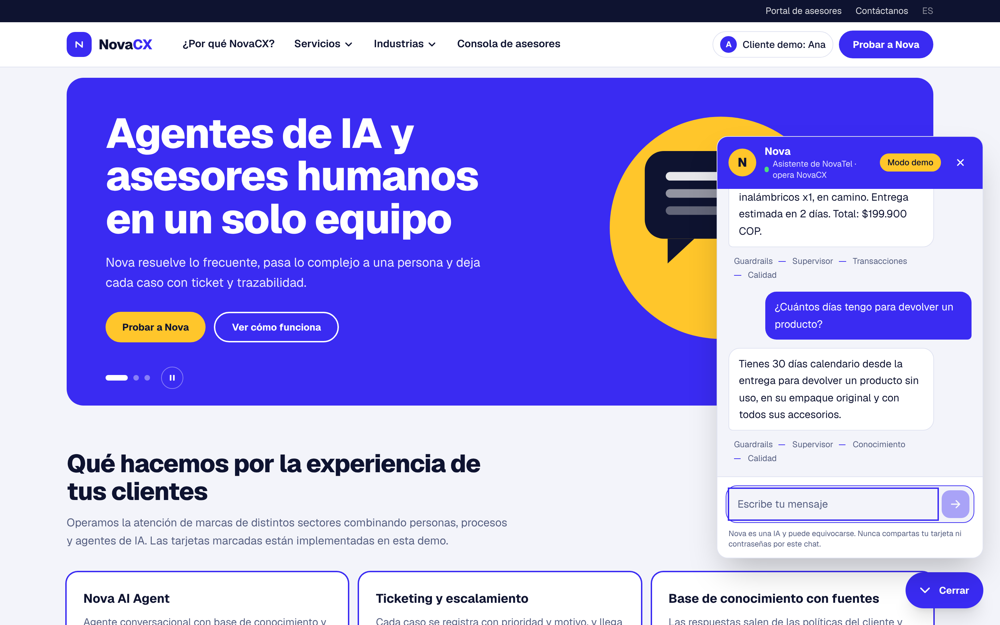
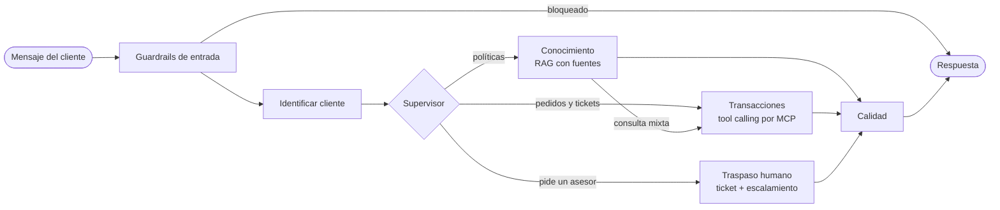
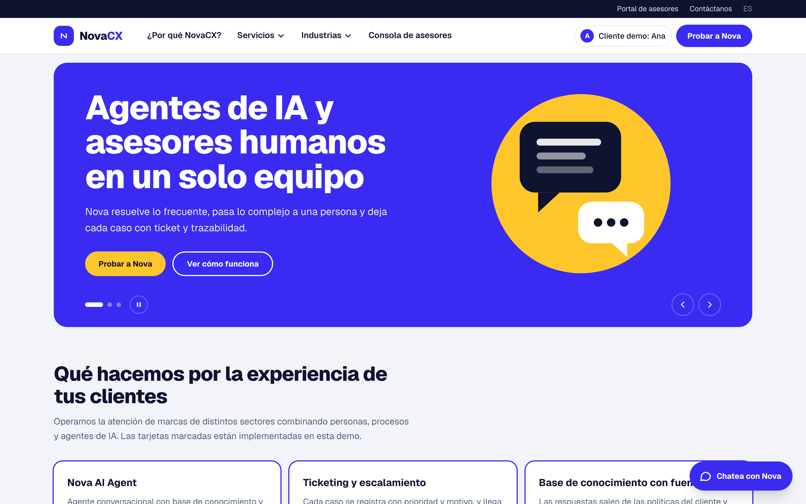
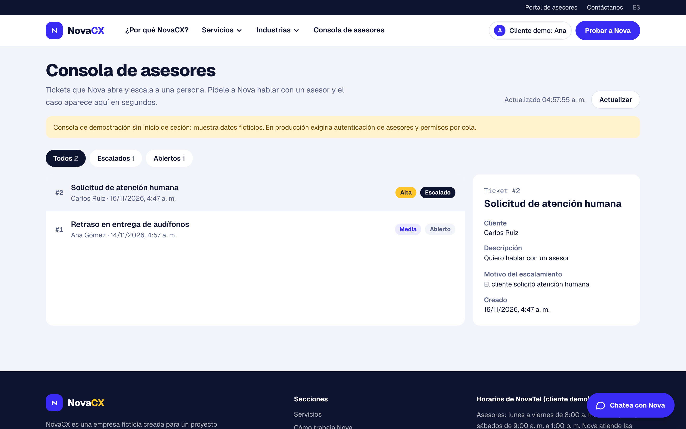
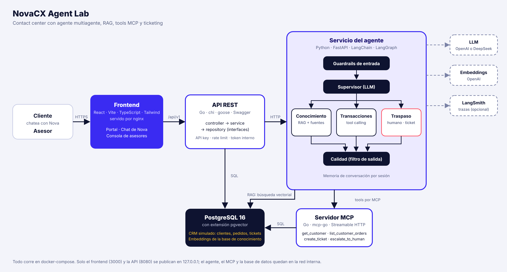

# NovaCX Agent Lab

Un contact center con **agente de IA multiagente, ticketing y consola de asesores**, construido como proyecto de práctica. NovaCX es un BPO ficticio que opera la atención de un cliente también ficticio (NovaTel, una tienda de tecnología). Todos los datos son de prueba.



## Qué problema resuelve

En un contact center una parte grande de los contactos son consultas repetitivas (¿cuánto tarda el envío?, ¿dónde está mi pedido?) que ocupan a los asesores y hacen esperar a los clientes. Resolverlas con IA introduce otros riesgos: respuestas inventadas, fugas de datos de otros clientes, casos que se pierden cuando el bot no puede ayudar.

Este proyecto muestra una forma de atacar ambos lados:

- **Nova responde lo frecuente** con información de la base de conocimiento del cliente y con datos reales de su CRM, citando la fuente.
- **Lo que no puede resolver se escala**: queda como un ticket con prioridad y motivo, visible en una consola para el asesor humano.
- **La seguridad no depende del prompt**: hay guardrails de entrada, autorización en código sobre las herramientas y un filtro de salida.

## Qué hace el agente

Nova no es un solo prompt, es un grafo de LangGraph con un supervisor y especialistas:



| Nodo | Qué hace | ¿Decide con un LLM? |
|---|---|---|
| Guardrails de entrada | Bloquea inyección de prompts y entradas abusivas antes de llegar al modelo | No (reglas) |
| Supervisor | Clasifica la intención y elige al especialista | Sí |
| Conocimiento | Busca en la base de conocimiento (pgvector) y responde citando fuentes | Una llamada |
| Transacciones | Consulta pedidos y tickets del cliente llamando herramientas MCP | Sí, decide qué herramienta usar |
| Traspaso humano | Crea el ticket y lo marca como escalado | No (determinista) |
| Calidad | Filtra la respuesta antes de enviarla (por ejemplo, tokens internos o emails ajenos) | No (reglas) |

Solo **Transacciones** es un agente en sentido estricto, porque elige sus herramientas. El resto son pasos del flujo con distinto grado de autonomía.

## Qué incluye

| Pieza | Descripción |
|---|---|
| **Portal NovaCX** | Landing de un BPO: navegación con menús de servicios e industrias, carrusel, sección de cómo trabaja Nova y chat flotante. |
| **Chat de Nova** | Widget conversacional. Un «Modo demo» muestra qué agentes, fuentes y herramientas usó cada respuesta. |
| **Consola de asesores** | Lista de tickets con prioridad, estado y motivo de escalamiento. Se actualiza sola. |
| **API REST (Go)** | Capas controller → service → repository conectadas por interfaces, migraciones con goose y Swagger. |
| **Servidor MCP (Go)** | Publica las herramientas del CRM (`get_customer`, `list_customer_orders`, `create_ticket`, `escalate_to_human`). |
| **Servicio del agente (Python)** | FastAPI + LangChain + LangGraph, RAG con pgvector, cliente MCP, trazas en LangSmith. |
| **Evaluación** | Dataset dorado de 25 casos y un ejecutor que mide aciertos, consistencia, latencia y ataques exitosos. |

| Portal | Consola de asesores |
|---|---|
|  |  |

## Arquitectura



El navegador solo habla con el frontend y este con la API de Go, que es la única puerta de entrada: valida, aplica rate limit y oculta el servicio del agente. El agente descubre las herramientas por MCP y comparte la base de datos con la API. Los diagramas C4, de despliegue local y de la propuesta en AWS están en [`docs/`](docs/).

## Tecnologías

| Capa | Tecnologías |
|---|---|
| Frontend | React 19, Vite, TypeScript, Tailwind v4, tipografía Geist, nginx |
| API | Go, chi, goose, swag (OpenAPI), pgx |
| Agente | Python 3.12, FastAPI, LangChain, LangGraph, langchain-postgres |
| Herramientas | Model Context Protocol (mcp-go, Streamable HTTP) |
| Datos | PostgreSQL 16 con pgvector |
| LLM | OpenAI (`gpt-4o-mini` por defecto) o DeepSeek |
| Observabilidad | LangSmith (opcional) |
| Despliegue | docker-compose; propuesta para GKE y AWS en `docs/` |

## Cómo se ejecuta

Necesitas Docker con Compose v2 y una API key de OpenAI (o DeepSeek).

```bash
cp .env.example .env
# Completa INTERNAL_TOKEN, API_KEY, POSTGRES_PASSWORD y CANARY_TOKEN
# (obligatorios, solo letras y números; sirve `openssl rand -hex 24`)
# y OPENAI_API_KEY.
docker compose up --build
```

- Portal: <http://localhost:3000> · Consola: <http://localhost:3000/#/consola>
- Swagger: <http://localhost:8080/swagger/> · Salud: `curl localhost:8080/healthz`
- Los puertos se publican solo en `127.0.0.1`. El agente, el MCP y la base de datos no salen de la red interna.
- Clientes demo: `ana.gomez@example.com`, `carlos.ruiz@example.com`, `laura.mejia@example.com`. Se eligen en la cabecera del portal.
- Tras cambiar código, reconstruye: `docker compose up -d --build`.

**Prueba rápida:** con Ana escribe «¿Dónde está mi pedido de los audífonos?» y luego «Quiero hablar con un asesor». Abre la consola: el ticket aparece escalado.

**DeepSeek.** `LLM_PROVIDER=deepseek`. No ofrece embeddings: mantén `EMBEDDINGS_PROVIDER=openai` o usa `hash` (sin red, solo demo, no es semántico).

**LangSmith.** `LANGSMITH_TRACING=true` y `LANGSMITH_API_KEY`. Los prompts y respuestas viajan a un tercero: usa solo datos ficticios.

## Pruebas y evaluación

```bash
# Agente (sin red ni API keys: usa un LLM falso)
cd agent && python -m venv .venv && . .venv/bin/activate
pip install -r requirements-dev.txt
pytest --cov=app --cov=evals && ruff check .

# Backend
cd backend && make tidy && make cover      # falla si la cobertura baja de 80 %

# Evaluar el agente contra el stack en marcha (consume tokens)
cd agent && python -m evals.run_evals --base-url http://localhost:8080 \
  --api-key $API_KEY --canary $CANARY_TOKEN --runs 3 --out evals/reports/report.json
```

Métricas y SLOs propuestos en [`docs/06-evaluacion-y-pruebas.md`](docs/06-evaluacion-y-pruebas.md).

## Estado de verificación

Lo que se ha comprobado y lo que no:

| Pieza | Estado |
|---|---|
| Agente Python | 78 tests pasan con cobertura del 90 % usando un LLM falso. |
| Backend Go | `make cover` da **93,3 %** en total. El paquete `mcpserver` queda en 74,1 %, por debajo del 80 % por sí solo. |
| Stack con docker-compose | Arranca y el chat responde de punta a punta: saludo, pregunta de políticas con fuente (devoluciones) y escalamiento con creación de ticket. |
| Consulta de pedidos por MCP | **Sin confirmar.** En una prueba el agente prometió listar pedidos sin llamar la herramienta; se corrigió el prompt, pero falta repetir la prueba. |
| Portal y consola | Compilan y se revisaron en un navegador con la API simulada. La consola **no se ha probado** contra el backend real. |
| Evaluaciones | Ejecutor y métricas probados con HTTP simulado. **Nunca se corrieron contra el stack real**: no hay resultados de calidad. |

## Limitaciones conocidas

- **La identidad es el email que envía el cliente** (no hay login). Cualquiera que conozca un email consulta sus pedidos (riesgo H1 en [`docs/04`](docs/04-riesgos-owasp-llm.md)).
- **La consola no pide autenticación** y el proxy del frontend inyecta la API key: cualquiera con acceso al puerto 3000 ve los tickets. Es válido solo para datos ficticios en local.
- Si `INTERNAL_TOKEN` y `API_KEY` quedan vacíos fuera de compose, la autenticación se desactiva.
- La memoria de conversación vive en el proceso (`InMemorySaver`): se pierde al reiniciar y no escala a varias réplicas.
- El rate limit se calcula por IP; detrás de nginx todos comparten contador.
- Cada petición abre una sesión MCP nueva; en producción convendría reutilizar la conexión.
- `requirements.txt` usa rangos sin lockfile: para builds reproducibles, congela versiones.
- «Escalar a un humano» solo marca el ticket; no hay integración real con una plataforma de contact center.

## Estructura

```
backend/    API REST y servidor MCP en Go (cmd/api, cmd/mcp, internal/..., migrations/)
agent/      Servicio Python: grafo, RAG, cliente MCP, knowledge/, evals/, tests/
frontend/   Portal, chat y consola (React + Vite)
docs/       C4, despliegue local y AWS, riesgos OWASP LLM, caso de estudio, evaluación
```

## Documentación

| Documento | Contenido |
|---|---|
| [`01-arquitectura-c4.md`](docs/01-arquitectura-c4.md) | C4 (contexto, contenedores, componentes), grafo del agente, secuencia del chat |
| [`02-despliegue-local.md`](docs/02-despliegue-local.md) | Topología de compose, variables, mapeo a GKE |
| [`03-despliegue-aws.md`](docs/03-despliegue-aws.md) | Propuesta de despliegue en AWS (solo diseño) |
| [`04-riesgos-owasp-llm.md`](docs/04-riesgos-owasp-llm.md) | OWASP LLM Top 10 2025, API Top 10 y STRIDE |
| [`05-caso-de-estudio.md`](docs/05-caso-de-estudio.md) | Caso empresarial e integraciones (CRM, contact center) |
| [`06-evaluacion-y-pruebas.md`](docs/06-evaluacion-y-pruebas.md) | Estrategia de pruebas, métricas y dataset dorado |
| [`07-observabilidad-langsmith.md`](docs/07-observabilidad-langsmith.md) | Observabilidad LLM |
| [`08-costos-multiagente.md`](docs/08-costos-multiagente.md) | Qué encarece una arquitectura multiagente |
| [`mcp-tools.md`](docs/mcp-tools.md) | Catálogo de tools MCP |

Los diagramas de `docs/` están en Mermaid, que GitHub renderiza directamente. En VS Code necesitas la extensión *Markdown Preview Mermaid Support*.

## Siguientes pasos

Canal de WhatsApp, despliegue en GKE (mapeo en `docs/02`) y propuesta de AWS de `docs/03`.
