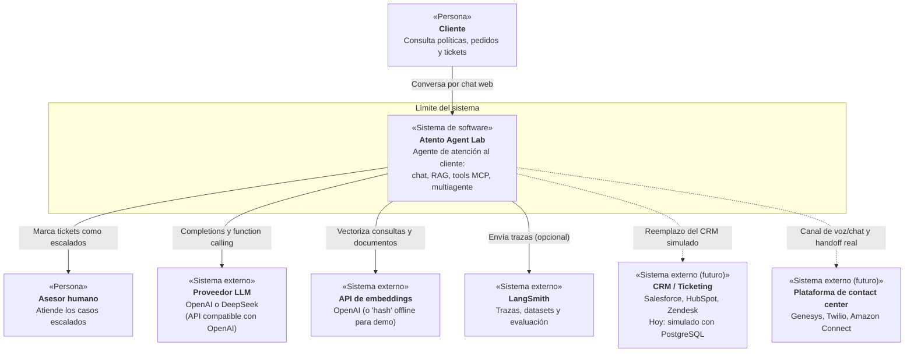
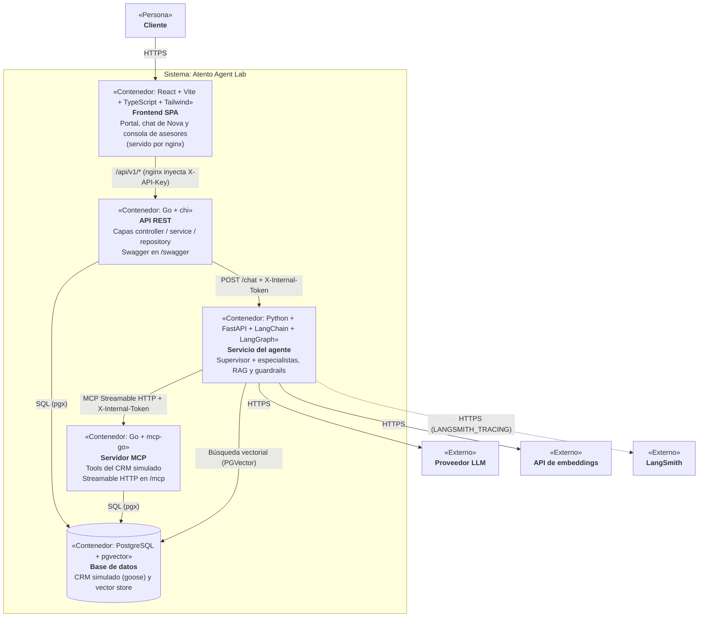
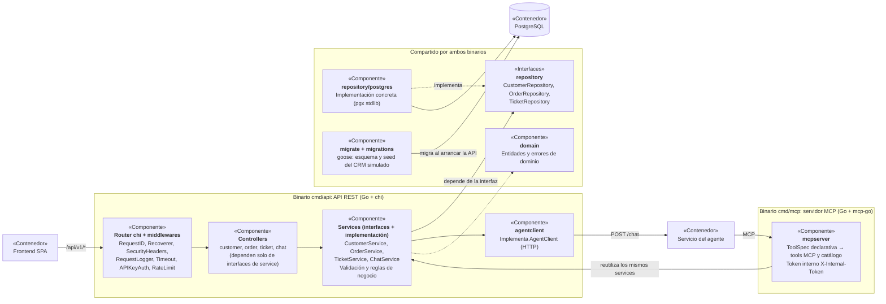
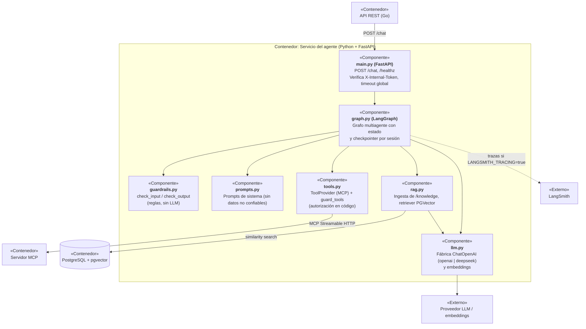
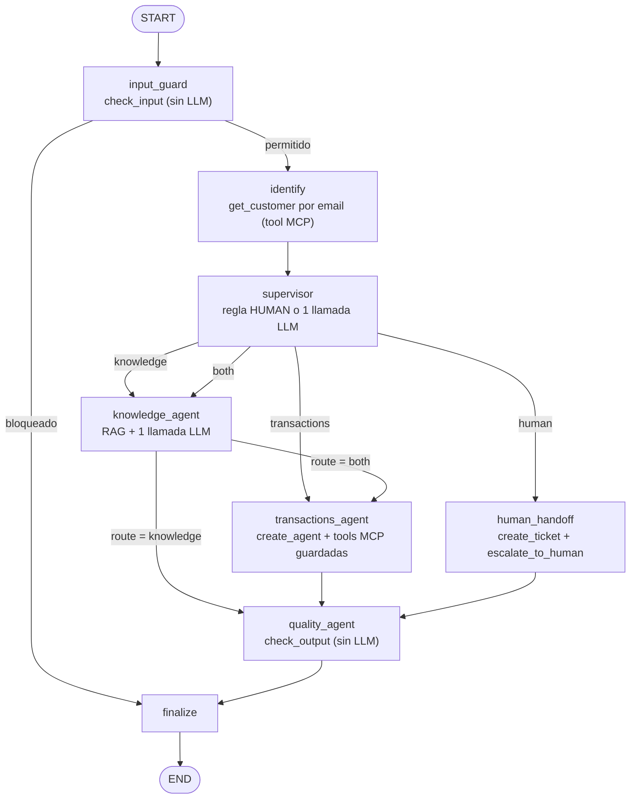
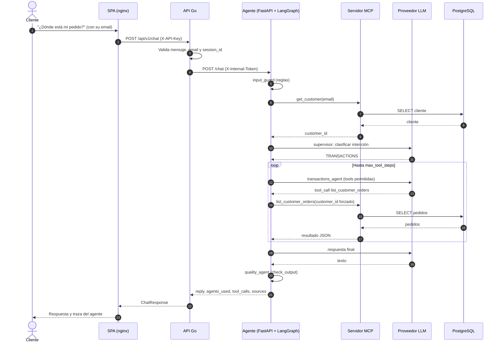

# Arquitectura (modelo C4)

Este documento describe **Atento Agent Lab**, un agente de atención al cliente construido como práctica técnica: frontend React, API en Go con capas, servidor MCP en Go y un servicio de agente en Python con LangChain y LangGraph.

Convención: los diagramas usan `flowchart` de Mermaid con etiquetas al estilo C4 (`«Persona»`, `«Contenedor: tecnología»`, `«Componente»`) y `subgraph` para los límites. No se usa la sintaxis experimental `C4Context`, para que renderice igual en GitHub y en `mmdc`.

> **Estado de verificación.** El servicio del agente (Python) tiene pruebas automáticas. El backend Go **no se ha podido compilar ni probar en la sandbox donde se generó** (el proxy de módulos de Go estaba bloqueado), así que sus diagramas describen el código escrito, no un comportamiento comprobado en ejecución.

## Decisiones de arquitectura que explican los diagramas

| Decisión | Motivo |
|---|---|
| El agente vive en Python (FastAPI + LangGraph) y el resto en Go | Aprender LangChain/LangGraph en su ecosistema natural, y conservar Go para la API, el modelo de capas y el servidor MCP. |
| El navegador **nunca** habla con el agente | La API Go es la única puerta de entrada: valida entradas, aplica rate limit y oculta el servicio del agente. |
| Las tools se publican por **MCP** (servidor Go) | El agente descubre las tools por protocolo; cualquier otro cliente MCP puede reutilizarlas. |
| Las tools del servidor MCP reutilizan los mismos *services* que la API REST | Una sola implementación de reglas de negocio; el CRM simulado se reemplaza cambiando el repositorio. |
| La autorización sobre las tools se aplica **en código** (`guard_tools`) | El prompt no es un control de seguridad. |

## Nivel 1: Contexto



<sub>Fuente: [`diagrams/c4-1-contexto.mmd`](diagrams/c4-1-contexto.mmd) · SVG: [`diagrams/c4-1-contexto.svg`](diagrams/c4-1-contexto.svg)</sub>

Notas:

- El CRM y el contact center aparecen punteados porque **hoy son simulados** (PostgreSQL con datos ficticios). El diseño los desacopla (ver [`05-caso-de-estudio.md`](05-caso-de-estudio.md)).
- Hoy, "escalar a un humano" solo marca el ticket como `escalated` en la base de datos. **No hay notificación ni integración real con un asesor ni con un contact center.**

## Nivel 2: Contenedores



<sub>Fuente: [`diagrams/c4-2-contenedores.mmd`](diagrams/c4-2-contenedores.mmd) · SVG: [`diagrams/c4-2-contenedores.svg`](diagrams/c4-2-contenedores.svg)</sub>

| Contenedor | Tecnología | Responsabilidad | Puerto |
|---|---|---|---|
| Frontend SPA | React, Vite, TypeScript, Tailwind, servido por nginx | Portal, chat de Nova (con modo demo de trazas) y consola de asesores. nginx reenvía `/api` a la API e inyecta `X-API-Key`. | 3000 (host) |
| API REST | Go, chi, goose, pgx | Endpoints `/api/v1`, Swagger, validación, rate limit, cliente del agente | 8080 |
| Servidor MCP | Go, mcp-go | Tools del CRM simulado vía Streamable HTTP en `/mcp` (o stdio con `-stdio`) | 8081 |
| Servicio del agente | Python, FastAPI, LangChain, LangGraph | Grafo multiagente, RAG, guardrails, memoria por sesión | 8000 |
| Base de datos | PostgreSQL con pgvector | Tablas del CRM simulado (goose) y vector store de la base de conocimiento | 5432 |

Autenticación entre contenedores:

- SPA → API: cabecera `X-API-Key`, inyectada por nginx (no vive en el JavaScript del navegador).
- API → agente y agente → MCP: cabecera `X-Internal-Token` (secreto compartido, comparación en tiempo constante en Go y `hmac.compare_digest` en Python). **Si `INTERNAL_TOKEN` queda vacío, ambos servicios aceptan llamadas sin autenticación**; compose debe definirlo siempre.

## Nivel 3: Componentes del backend Go



<sub>Fuente: [`diagrams/c4-3-componentes-backend.mmd`](diagrams/c4-3-componentes-backend.mmd) · SVG: [`diagrams/c4-3-componentes-backend.svg`](diagrams/c4-3-componentes-backend.svg)</sub>

Reglas de dependencia (el sentido de las flechas importa):

1. `controller` depende solo de las **interfaces** de `service`.
2. `service` depende solo de las **interfaces** de `repository` (`CustomerRepository`, `OrderRepository`, `TicketRepository`) y de `AgentClient`.
3. `repository/postgres` es la implementación concreta; es el único paquete que conoce SQL.
4. `cmd/api` y `cmd/mcp` son las raíces de composición: construyen repositorios concretos → services → controllers / tools.
5. `domain` no depende de nada.

Esto permite probar `service` con repositorios falsos y `controller` con services falsos, y cambiar PostgreSQL por otra fuente (por ejemplo un CRM real) sin tocar la lógica de negocio.

## Nivel 3: Componentes del servicio del agente



<sub>Fuente: [`diagrams/c4-3-componentes-agente.mmd`](diagrams/c4-3-componentes-agente.mmd) · SVG: [`diagrams/c4-3-componentes-agente.svg`](diagrams/c4-3-componentes-agente.svg)</sub>

### Grafo del agente (LangGraph)



<sub>Fuente: [`diagrams/c4-3-grafo-agente.mmd`](diagrams/c4-3-grafo-agente.mmd) · SVG: [`diagrams/c4-3-grafo-agente.svg`](diagrams/c4-3-grafo-agente.svg)</sub>

| Nodo | Usa LLM | Qué hace |
|---|---|---|
| `input_guard` | No | Valida largo, detecta patrones de inyección, redacta tarjetas (Luhn) y secretos. Si bloquea, el mensaje del historial se reemplaza por `[mensaje bloqueado]`. |
| `identify` | No (tool MCP) | Resuelve `customer_id` a partir del email con `get_customer`. |
| `supervisor` | Sí (1 llamada), salvo regla `HUMAN` | Clasifica en `KNOWLEDGE`, `TRANSACTIONS`, `BOTH` o `HUMAN`. Una expresión regular fuerza `HUMAN` ante "asesor", "supervisor", etc. Si la etiqueta del LLM no es válida, hay un respaldo determinista. |
| `knowledge_agent` | Sí (1 llamada) | Recupera `k` fragmentos (PGVector) y responde solo con ese contexto, que viaja delimitado en `<contexto>`. |
| `transactions_agent` | Sí (bucle de tools) | `create_agent` con las tools MCP **envueltas** por `guard_tools`. Límite de pasos por `max_tool_steps`. |
| `human_handoff` | No | Llama de forma determinista a `create_ticket` y `escalate_to_human`. |
| `quality_agent` | No | Aplica `check_output`: canary, secretos, tarjetas y emails ajenos. **No verifica si la respuesta está fundamentada**; el nombre sugiere más de lo que hace. |
| `finalize` | No | Agrega la respuesta al historial. |

## Secuencia de una consulta transaccional



<sub>Fuente: [`diagrams/secuencia-chat.mmd`](diagrams/secuencia-chat.mmd) · SVG: [`diagrams/secuencia-chat.svg`](diagrams/secuencia-chat.svg)</sub>

## Contrato del chat

`POST /api/v1/chat` (API Go) reenvía a `POST /chat` (agente):

```json
// Solicitud
{ "session_id": "opcional", "message": "¿Dónde está mi pedido?", "customer_email": "ana.gomez@example.com" }

// Respuesta
{
  "session_id": "9f1c...",
  "reply": "Tu pedido va en camino...",
  "escalated": false,
  "agents_used": ["guardrails", "supervisor", "transactions", "quality"],
  "sources": [],
  "tool_calls": [{ "name": "list_customer_orders", "args": { "customer_id": 1 } }]
}
```

`agents_used`, `sources` y `tool_calls` alimentan el modo demo del chat (trazas) en el frontend.
