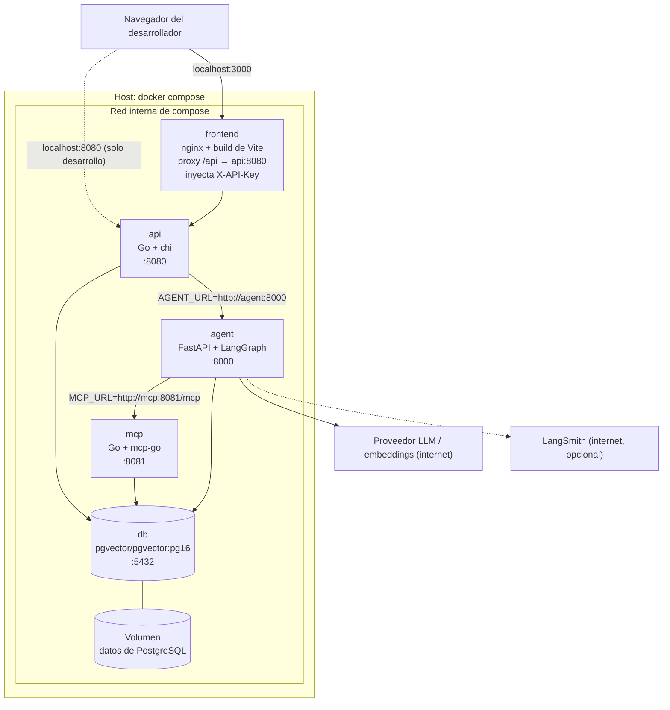

# Despliegue local con docker-compose

Entorno de práctica: todo corre en una sola máquina con `docker compose`. El siguiente paso previsto es GKE (sección final, solo como guía, sin manifiestos).

> **Estado de verificación.** Este documento describe la topología objetivo. La sandbox donde se generó el proyecto no tiene demonio Docker, por lo que `docker compose up` **no se ha ejecutado**. Los puertos y nombres de servicio son los acordados para el `docker-compose.yml` del repositorio; si difieren, el archivo compose manda.

## Topología



<sub>Fuente: [`diagrams/despliegue-local.mmd`](diagrams/despliegue-local.mmd) · SVG: [`diagrams/despliegue-local.svg`](diagrams/despliegue-local.svg)</sub>

| Servicio | Imagen / build | Puerto | Publicado al host | Notas |
|---|---|---|---|---|
| `db` | `pgvector/pgvector:pg16` | 5432 | No (red interna) | Volumen persistente. Lo usan la API (goose), el MCP y el agente (vector store). |
| `api` | build de `backend/` (binario `api`) | 8080 | Sí, solo para desarrollo | Ejecuta las migraciones goose al arrancar. Sondas `/healthz` y `/readyz`. |
| `mcp` | build de `backend/` (binario `mcp`) | 8081 | No | Endpoint `/mcp` protegido con `X-Internal-Token`. |
| `agent` | build de `agent/` | 8000 | No | Indexa `agent/knowledge/*.md` al arrancar (`INGEST_ON_STARTUP`). |
| `frontend` | build de `frontend/` (nginx) | (interno) | **3000** | Sirve el build de Vite y hace proxy de `/api` → `api:8080` inyectando `X-API-Key`. |

Regla de exposición: al host solo salen `frontend` (3000) y, para depurar con Swagger o `curl`, `api` (8080). El agente, el MCP y la base de datos **no** se publican. En un entorno compartido, quita también el 8080.

## Variables clave

Se definen en un `.env` (no se versiona; hay un `.env.example`).

| Variable | Quién la usa | Para qué |
|---|---|---|
| `INTERNAL_TOKEN` | api, agent, mcp | Secreto compartido de las llamadas internas. **Obligatorio**: vacío desactiva la autenticación interna. |
| `API_KEY` | api, frontend (nginx) | Protege `/api/v1`. Vacío desactiva la autenticación. |
| `LLM_PROVIDER` | agent | `openai` (por defecto) o `deepseek`. |
| `OPENAI_API_KEY`, `OPENAI_MODEL` | agent | Modelo de chat y embeddings. |
| `DEEPSEEK_API_KEY`, `DEEPSEEK_MODEL`, `DEEPSEEK_BASE_URL` | agent | Alternativa de menor costo (API compatible con OpenAI). |
| `EMBEDDINGS_PROVIDER` | agent | `openai` o `hash` (offline, solo demo: embeddings léxicos, no semánticos). |
| `CANARY_TOKEN` | agent | Token señuelo para detectar fuga del prompt. Cámbialo: el valor por defecto está en el repositorio. |
| `DATABASE_URL` | api, mcp | Conexión pgx (`postgres://...`). |
| `VECTOR_DATABASE_URL` | agent | Conexión SQLAlchemy/psycopg (`postgresql+psycopg://...`). |
| `AGENT_URL`, `MCP_URL` | api, agent | `http://agent:8000` y `http://mcp:8081/mcp`. |
| `LANGSMITH_TRACING`, `LANGSMITH_API_KEY`, `LANGSMITH_PROJECT` | agent | Observabilidad (ver [`07-observabilidad-langsmith.md`](07-observabilidad-langsmith.md)). |

Orden de arranque esperado: `db` (healthy) → `api` (migra y siembra el CRM simulado) → `mcp` → `agent` (reintenta la conexión MCP hasta 5 veces) → `frontend`.

Pruebas rápidas una vez arriba:

```bash
curl -s localhost:8080/healthz
curl -s -H "X-API-Key: $API_KEY" localhost:8080/api/v1/customers
open http://localhost:3000        # chat
open http://localhost:8080/swagger/   # documentación OpenAPI
```

Datos semilla (ficticios): clientes `ana.gomez@example.com`, `carlos.ruiz@example.com` y `laura.mejia@example.com`.

## Puntos de atención conocidos

- **Rate limit detrás de nginx.** El límite de la API se calcula por `RemoteAddr`. Con el proxy de nginx delante, todos los usuarios comparten la IP del contenedor y por tanto el mismo contador (60 peticiones/minuto por defecto).
- **Memoria de conversación en proceso.** El agente usa `InMemorySaver`: se pierde al reiniciar y no se comparte entre réplicas.
- **Extensión `vector`.** `langchain-postgres` intenta crearla al conectar; con la imagen `pgvector/pgvector` el usuario de la base de datos del compose tiene permisos para ello.
- **Swagger UI** carga sus assets desde `unpkg.com`; sin internet no se verá la interfaz (el JSON de OpenAPI sí se sirve).

## Siguiente paso: GKE

Mapeo previsto (sin manifiestos por ahora):

| Compose | Kubernetes |
|---|---|
| `frontend`, `api`, `agent`, `mcp` | Un `Deployment` + `Service` (ClusterIP) por servicio. |
| Exposición al host | `Ingress` (GKE Ingress / Gateway API) con TLS gestionado hacia `frontend`; `/api` hacia `api`. El agente y el MCP quedan solo como ClusterIP. |
| `.env` | `Secret` para `INTERNAL_TOKEN`, `API_KEY`, claves de LLM y LangSmith; `ConfigMap` para el resto. Valorar Secret Manager con CSI driver. |
| Healthchecks | `livenessProbe` en `/healthz` y `readinessProbe` en `/readyz` (API); `/healthz` en agente y MCP. |
| `db` | Cloud SQL for PostgreSQL con pgvector (opción preferida) o un `StatefulSet` con volumen persistente. |
| Migraciones | Mantener goose al arrancar la API o pasar a un `Job` previo al despliegue si hay varias réplicas. |
| Memoria del agente | Antes de escalar a más de una réplica del agente, cambiar `InMemorySaver` por un checkpointer en PostgreSQL. |
| Seguridad de red | `NetworkPolicy`: solo `api` → `agent`, solo `agent` → `mcp`, solo `api`/`mcp`/`agent` → base de datos. |
| Límites | `resources.requests/limits` y `HorizontalPodAutoscaler` para `api` y `agent`. |
