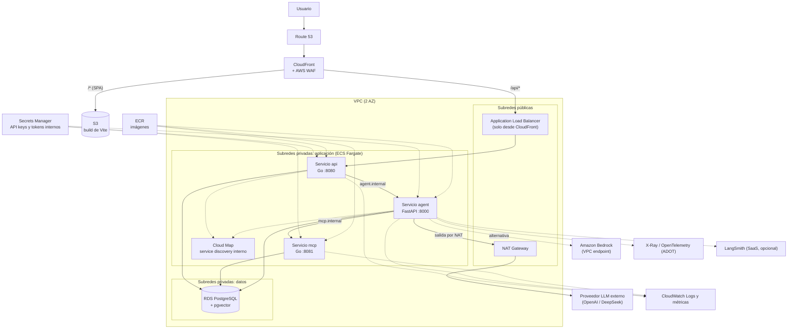

# Propuesta de despliegue en AWS

> **Solo diseño.** Nada de esto está implementado ni probado. Es la propuesta para llevar la solución de docker-compose a AWS, escrita para discutirla (por ejemplo, en una entrevista o revisión de arquitectura). La infraestructura como código sugerida es AWS CDK.

## Diagrama

Fuente: [`diagrams/despliegue-aws.mmd`](diagrams/despliegue-aws.mmd) · SVG: [`diagrams/despliegue-aws.svg`](diagrams/despliegue-aws.svg)

## Componentes y justificación

| Capa | Servicio AWS | Por qué |
|---|---|---|
| DNS | Route 53 | Registro hacia CloudFront. |
| Borde | CloudFront + AWS WAF | TLS, caché del SPA, reglas gestionadas (inyección, bots) y *rate limiting* por IP real, que en la API actual no es fiable detrás de proxies. |
| SPA | S3 (privado) + CloudFront (OAC) | Hosting estático barato; sin servidor que operar. Alternativa: Amplify Hosting. |
| Entrada de la API | ALB en subredes públicas, **restringido a CloudFront** (lista de prefijos gestionada de CloudFront y cabecera secreta) | Evita saltarse el WAF yendo directo al ALB. |
| Cómputo | ECS Fargate: servicios `api`, `agent`, `mcp` | Sin gestionar nodos; un servicio por contenedor, igual que en compose. |
| Descubrimiento interno | AWS Cloud Map (`agent.internal`, `mcp.internal`) | Mantiene `AGENT_URL` y `MCP_URL` como nombres estables. Solo `api` queda detrás del ALB. |
| Datos | RDS PostgreSQL (extensión `pgvector`) en subredes privadas, Multi-AZ en producción | Un solo motor para CRM simulado y vectores. |
| Secretos | Secrets Manager | `INTERNAL_TOKEN`, `API_KEY`, claves del LLM, `CANARY_TOKEN`, credenciales de RDS. Inyectados como secretos de la *task definition*. |
| Imágenes | ECR con escaneo al subir | Cadena de suministro (ver LLM03 en [`04-riesgos-owasp-llm.md`](04-riesgos-owasp-llm.md)). |
| Salida a Internet | NAT Gateway | El agente necesita llegar al proveedor LLM y a LangSmith. |
| Observabilidad | CloudWatch Logs/métricas, X-Ray vía AWS Distro for OpenTelemetry; LangSmith para trazas del agente | Infraestructura en AWS, comportamiento del LLM en LangSmith. |
| IaC | AWS CDK (TypeScript o Python) | Ya forma parte del stack de trabajo habitual. |

## Alternativas

**Proveedor LLM.** Amazon Bedrock evita enviar datos a un tercero fuera de AWS y permite acceso por VPC endpoint, IAM en lugar de API keys y facturación unificada. El cambio en código es acotado: `llm.py` es la única fábrica del modelo (hoy `ChatOpenAI`; con Bedrock se usaría el integrador correspondiente de LangChain). Hay que **revalidar function calling y calidad con el dataset dorado**, porque cambia el modelo.

**Almacén vectorial.**

| Opción | Ventajas | Desventajas |
|---|---|---|
| pgvector en RDS (propuesta) | Un solo motor, transacciones, simple | Escala vectorial limitada frente a servicios dedicados |
| Aurora PostgreSQL + pgvector | Mejor disponibilidad y lectura escalable | Más costo y complejidad |
| OpenSearch Serverless / Managed | Búsqueda híbrida (texto + vector) nativa, escala | Costo base más alto; otro sistema que operar |
| Bedrock Knowledge Bases | Ingesta gestionada | Menos control del chunking y del retriever, acopla a Bedrock |

**Cómputo.** ECS Fargate es la opción más simple. EKS tendría sentido si el equipo ya opera Kubernetes (por ejemplo, para reutilizar lo aprendido en GKE), a cambio de más operación.

## Seguridad

- Las tres capas de red separadas: pública (ALB, NAT), aplicación (ECS) y datos (RDS), con *security groups* mínimos: ALB → `api`; `api` → `agent`; `agent` → `mcp`; `api`, `mcp` y `agent` → RDS; nada más.
- **Autenticación de usuarios.** El esquema actual (una `X-API-Key` estática inyectada por nginx y el "email como identidad" en el chat) es de laboratorio. Para producción, Amazon Cognito (o el IdP corporativo) debe emitir un JWT que la API valide y del que se derive el `customer_id`, en lugar de aceptarlo del cuerpo de la petición.
- Roles IAM por tarea con permisos mínimos; RDS con cifrado en reposo, TLS y usuarios de base de datos separados (la API/MCP con acceso a las tablas del CRM; el agente solo al esquema vectorial).
- WAF delante de CloudFront; Secrets Manager con rotación; registros sin cuerpos de mensajes.

## Escalado y disponibilidad

- `api` y `mcp` son sin estado: *auto scaling* por CPU/solicitudes.
- `agent` es sin estado **solo si** se reemplaza `InMemorySaver` por un checkpointer persistente (PostgreSQL); de lo contrario habría que fijar la afinidad de sesión.
- El cuello de botella suele ser la latencia y los límites de tasa del proveedor LLM, no el cómputo: conviene reintentos con *backoff*, límites de concurrencia y un presupuesto por sesión.
- RDS: Multi-AZ y copias de seguridad automáticas; pruebas de restauración.

## Costos (cualitativo)

Sin cifras: los precios cambian y dependen de la región. Los componentes que suelen pesar más: el **NAT Gateway** (horas + datos), el **RDS Multi-AZ**, el **ALB**, las tareas Fargate permanentes y, sobre todo, los **tokens del LLM** (ver [`08-costos-multiagente.md`](08-costos-multiagente.md)). Para una práctica se puede reducir a una AZ, sin Multi-AZ y con `desiredCount = 1`. Calcula con AWS Pricing Calculator antes de decidir.

## Trade-offs

| Decisión | Beneficio | Costo / riesgo |
|---|---|---|
| Fargate frente a EKS | Menos operación | Menos control de red y de *scheduling* |
| Todo en una sola base de datos | Simplicidad | Radio de impacto compartido; separar usuarios y, a futuro, instancias |
| LLM externo frente a Bedrock | Mejor modelo disponible / ya probado | Datos salen de AWS; dependencia de un tercero; requiere NAT |
| LangSmith SaaS | Mejor depuración de agentes | Los datos de conversación salen a un SaaS; evaluar redacción y acuerdos de tratamiento |
| CloudFront + S3 para el SPA | Barato y escalable | Dos orígenes (S3 y ALB) con políticas de caché distintas |
